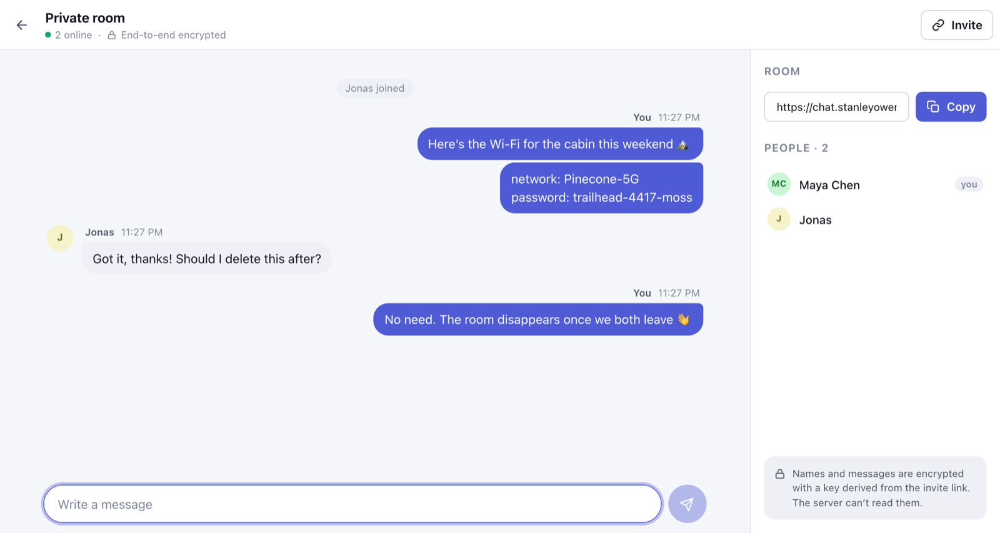
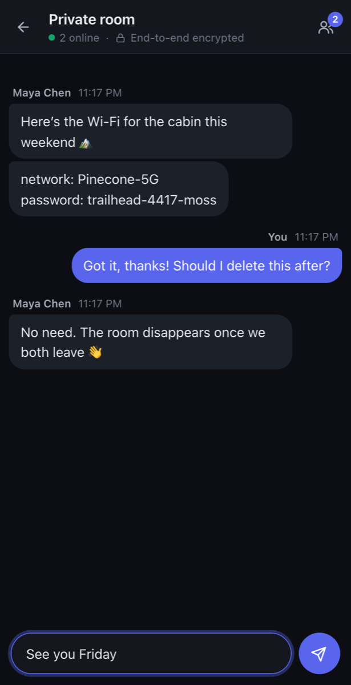

<div align="center">


# Quietroom

**Private chat rooms that leave no trace.**

End-to-end encrypted in your browser. No accounts, no history, no trackers.

[](https://github.com/stanleyowen/quietroom/actions/workflows/ci.yml)
[](https://app.netlify.com/projects/quietchat/deploys)
[](LICENSE)

[**Open Quietroom**](https://chat.stanleyowen.com) &nbsp;·&nbsp; [How it works](#how-it-works) &nbsp;·&nbsp; [Security](#security) &nbsp;·&nbsp; [Self-hosting](#self-hosting)

<br>

&nbsp;&nbsp;

</div>

<br>

## Why Quietroom

Some things shouldn't sit in a chat history forever: a Wi-Fi password, a door code, a quick "can we talk privately?". Quietroom gives you a room for that conversation and then forgets it.

| | |
| --- | --- |
| **End-to-end encrypted** | Messages *and* display names are encrypted in your browser with AES-256-GCM. The server relays ciphertext it cannot read. |
| **Nothing is stored** | No database, no message history, no request logs. When the last person leaves, the room no longer exists anywhere. |
| **No accounts** | Pick a display name and go. It is kept for that browser tab only. |
| **No tracking** | No cookies, analytics, web fonts or third-party requests. A strict Content-Security-Policy enforces it. |
| **Fast and small** | About 82 KB gzipped. The client's only runtime dependency is React, and the server's only one is `ws`. |
| **Works everywhere** | Phone and desktop, light and dark mode, keyboard and screen-reader friendly, and it reconnects on its own. |

## How it works

1. **Create a room.** You get an invite link like `https://…/#7kq2m-xv9ph-3dwz8-rb4tn`.
2. **Share the link.** The part after `#` is the room's secret. Browsers never send it to any server, not even ours.
3. **Talk.** Your browser turns the secret into an encryption key and a room id. The relay only sees the id and encrypted blobs.
4. **Leave.** Close the tab and your copy is gone. When everyone has left, so is the room.

```
                     URL fragment (#…) – never leaves the browser
                                │
 Browser ── room code ──PBKDF2──┴─HKDF──┬─▶ room id ─────────────────┐
                                        └─▶ AES-256-GCM key (local)  │
                                                                     ▼
 Netlify (static app)        Cloudflare Tunnel ─▶ relay in Docker (memory only)
                             sees: opaque room id, ciphertext, timing
```

You can also join by typing a room *name*, as in the original app. Anyone who guesses that name can get in, so the app warns you. Generated codes carry 100 bits of randomness.

## Security

### What the server can and can't see

| The relay or a network attacker **cannot** | The relay **can** |
| --- | --- |
| read messages or display names | see that a room exists, how many people are in it, and when they send messages |
| learn the room code or invite link | see connecting IP addresses (kept in memory for rate limiting, never logged) |
| forge or change messages (authenticated encryption, sender bound inside the ciphertext) | drop or delay messages |
| replay a message to someone who already received it | re-send an old message to someone who joined later |

Anyone with the invite link is a full member of the room, so treat it like a password. As with every web app, you trust whoever serves the JavaScript: here, that's the Netlify site built from this repository.

<details>
<summary><b>Hardening details</b></summary>

**Relay**
- Strict Origin allow-list on the WebSocket handshake (CORS does not cover WebSockets)
- Every frame validated against a strict schema; malformed or binary frames close the socket
- Limits on frame size (16 KB), room size (50), rooms, total and per-IP connections, plus token-bucket rate limiting
- Join timeout, ping/pong heartbeat, and backpressure, so slow readers get dropped
- No compression and no persistence

**Container**
- Runs as uid 10001 with a read-only filesystem, no Linux capabilities, and `no-new-privileges`
- On an internal Docker network with **no internet access**; only the cloudflared sidecar can reach it
- No host ports are published; TLS terminates at Cloudflare
- Base images pinned by digest, package managers removed, dependencies installed with `npm ci --ignore-scripts`

**Client**
- CSP `default-src 'none'` with Trusted Types, no inline code, no `eval`, and `connect-src` pinned to the relay
- Everything renders as text, never HTML; bidi-override and control characters are stripped
- `Referrer-Policy: no-referrer`, HSTS, and a locked-down `Permissions-Policy`

**Supply chain**
- Lockfiles and `npm ci` everywhere, `npm audit` and an image smoke test in CI, Dependabot for npm, Docker and Actions

</details>

Found a vulnerability? Please [report it privately](https://github.com/stanleyowen/quietroom/security/advisories/new) rather than opening a public issue.

## Self-hosting

Quietroom has two parts: a static web app and a small WebSocket relay.

### Local development

Requires **Node.js 24+** (`nvm use` picks up `.nvmrc`, which is Node 26 LTS).

```bash
npm run install:all     # install client/ and server/
npm run dev:server      # relay on ws://localhost:8787/ws
npm run dev:client      # app on http://localhost:5173
npm run check           # typecheck, lint and test both
```

> On macOS, keep the relay off port 5000. AirPlay Receiver uses it and answers `403`.

### Relay: Docker and Cloudflare Tunnel

The relay runs as two containers: the relay itself and a `cloudflared` sidecar that connects out to Cloudflare. Nothing listens on the host.

```bash
./deploy/deploy.sh                              # default: stanley@192.168.1.100
./deploy/deploy.sh stanley@ssh.stanleyowen.com  # remotely, via Cloudflare Access
```

The script runs the tests, copies the source over SSH, rebuilds the image, starts the stack, and checks `https://chat-api.stanleyowen.com/healthz`. It never needs sudo and never touches the server's `.env`.

<details>
<summary><b>First-time setup on a new server</b></summary>

You need Docker with the compose plugin, rsync, and a Cloudflare-managed domain.

```bash
cloudflared tunnel create quietroom-api
cloudflared tunnel route dns quietroom-api chat-api.example.com
mkdir -m 700 -p ~/server/quietroom && cd ~/server/quietroom
umask 077 && printf 'ALLOWED_ORIGINS=https://your-site.netlify.app\nTUNNEL_TOKEN=%s\n' \
  "$(cloudflared tunnel token quietroom-api)" > .env
```

Then run `./deploy/deploy.sh user@your-server` from your machine. To allow another web origin, add it to `ALLOWED_ORIGINS` (comma separated) and run `docker compose up -d` in `~/server/quietroom`.

</details>

<details>
<summary><b>Day-to-day operations</b></summary>

```bash
ssh stanley@192.168.1.100
cd ~/server/quietroom
docker compose ps            # status and health
docker compose logs -f       # intentionally almost empty
docker compose restart relay
```

</details>

### Web app: Netlify

The app is served from **[chat.stanleyowen.com](https://chat.stanleyowen.com)** (Netlify site `quietchat`, with a Cloudflare DNS record pointing at it). `netlify.toml` builds `client/` on Node 26, runs lint and tests, and points the app at `wss://chat-api.stanleyowen.com/ws`. Leave **Base directory** empty in the Netlify dashboard so this file is used. The build also writes a `_headers` file containing the CSP and security headers.

## Built with

| Part | Stack |
| --- | --- |
| Client | React 19, Vite 8, TypeScript 7, Web Crypto API, plain CSS |
| Relay | Node.js 26 (TypeScript run natively), `ws` |
| Hosting | Netlify at chat.stanleyowen.com (client); Docker and Cloudflare Tunnel at chat-api.stanleyowen.com (relay) |
| Tooling | Vitest, oxlint, GitHub Actions, Dependabot |

```
client/   web app (deploys to Netlify)
server/   WebSocket relay
shared/   wire protocol and limits used by both
deploy/   Dockerfile, docker-compose, and the deploy script
```

## Contributing

Ideas and bug reports are welcome. Please read the [contributing guide](CONTRIBUTING.md) and [code of conduct](CODE_OF_CONDUCT.md), then [open an issue](https://github.com/stanleyowen/quietroom/issues/new/choose).

## License

[MIT](LICENSE) © Stanley Owen
